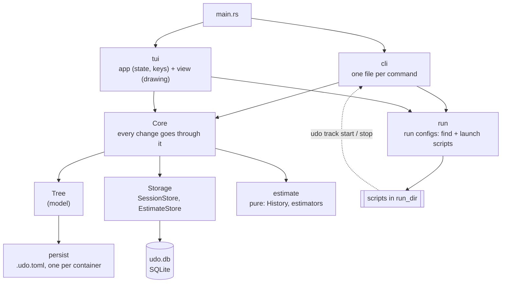

# Architecture

How udo is put together: the layers, the data, and what happens when
something changes. The diagrams are coarse on purpose: types, how they
relate and the order of steps, not every method. The methods are in the
API docs:

```sh
cargo doc --document-private-items --open
```

A change to the layers, the stored data or one of the flows updates these
files in the same pull request.

## Layers



- **`Core`** (`src/core/`) owns the tree and the stores. The CLI and the
  TUI only read the tree; every change is a `Core` method, so both behave
  the same.
- **`model`** (`src/model/`) is the data and its rules, without I/O apart
  from loading and saving the tree's files.
- **`storage`** (`src/storage/`) keeps what is recorded over time
  (sessions, estimate rows) in `udo.db`, each behind a trait.
- **`estimate`** (`src/estimate/`) computes estimates from a snapshot
  (`History`); no I/O, no async.
- **`run`** (`src/run/`) finds and starts run configs. udo starts no timer
  for a run: the scripts call `udo track` themselves
  ([run configs](../run-configs.md)).

## Reading order

1. [model.md](model.md): the tree in memory and on disk, the view state
2. [storage.md](storage.md): sessions and estimate rows in `udo.db`
3. [estimates.md](estimates.md): how an estimate is computed and recorded
4. [flows.md](flows.md): load, create, edit, delete, save, the timer
