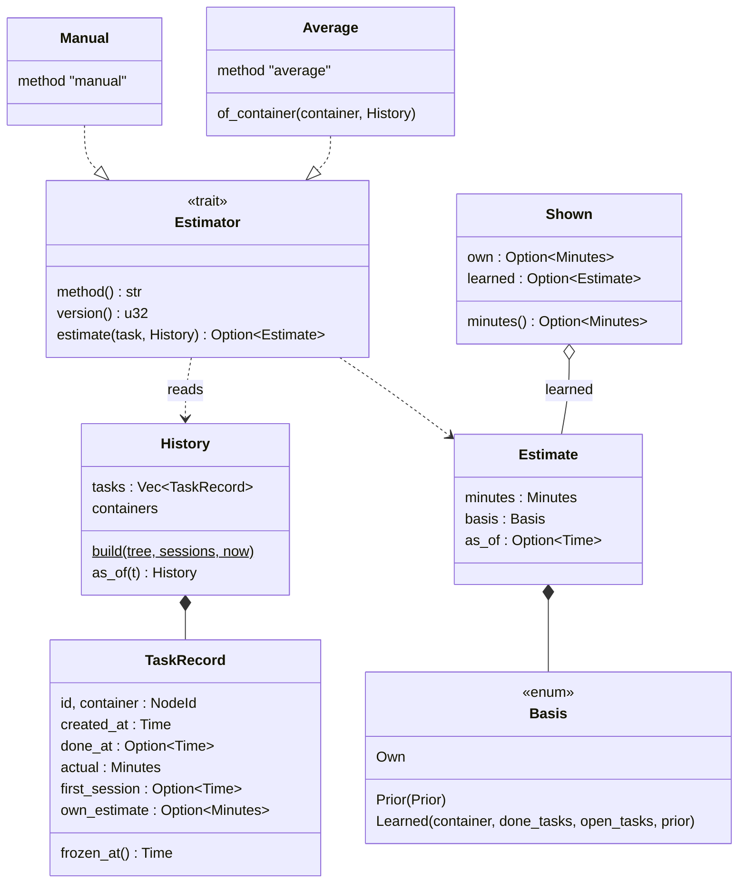
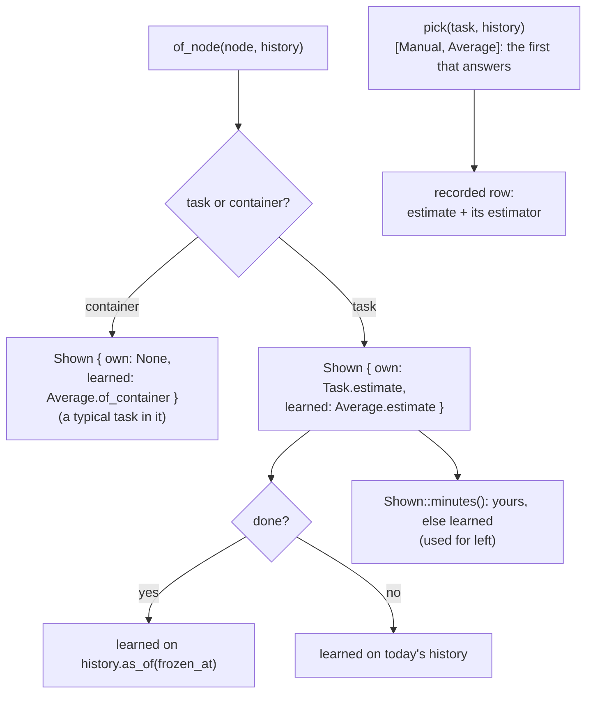

# Estimates

How long a task will take, learned from the recorded time (`src/estimate/`).
The module is pure: `Core` builds a snapshot (`History`), the estimators
only read it. The math (the average, its prior, weights) is explained in
the doc comments of `src/estimate/average.rs`.

- **`History`** is the tree's tasks plus their sessions, read once
  (`Core::history`). Deleted tasks are in it too, from their sessions.
  `as_of(t)` cuts it back to what was known at `t`: later tasks dropped,
  sessions cut at `t`, tasks done later count as open.
- **`Average`** blends a container's tasks with a prior (the container's
  `estimate` setting, else what the parent's tasks give). `Manual` gives
  the task's own estimate. Both are `Estimator`s; method and version go
  into every recorded row.
- **A done task's learned estimate is frozen** at its first session
  (`TaskRecord::frozen_at`): computed on `history.as_of(frozen_at)`, so it
  never changes afterwards and can be compared with the actual time.

## What udo shows and goes by

- **`of_node`** gives both values (`Shown`), so the TUI and `udo estimate`
  can show yours next to what udo learned.
- **`pick`** is the one place the order "yours, else learned" lives; it
  also returns the estimator, whose method and version go into the row.
  `Shown::minutes` follows the same order.

## Recording

`Core` writes an estimate row (see [storage.md](storage.md#estimate-rows))
after an action, never before it. A failed write never undoes the action:
it becomes a warning (`estimate not recorded: …`) that the CLI prints to
stderr and the TUI shows as a toast.

| Moment | When | The row |
|--------|------|---------|
| `Created` | `Core::create` of a task | `pick` as of its creation, reason `created` |
| `Started` | its first session (`start`, `track start`, an added session) | `pick` as of that session, reason `started`; later sessions: no row |
| `Edited` | `Core::edit` changed the own estimate | set or changed: `Manual`, reason `manual`; removed: the learned one as shown, reason `cleared` |

No row for containers, when nothing can be estimated yet, or when it would
repeat the task's latest row.
