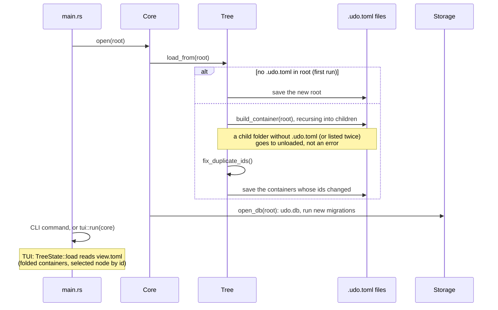
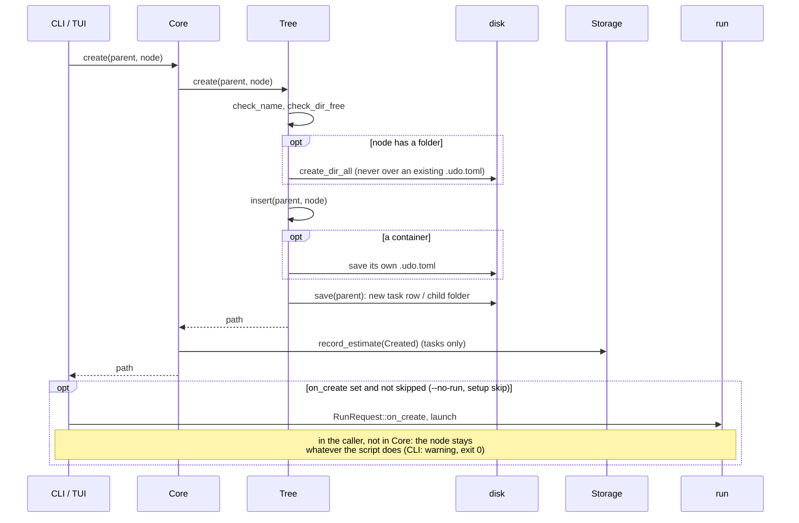
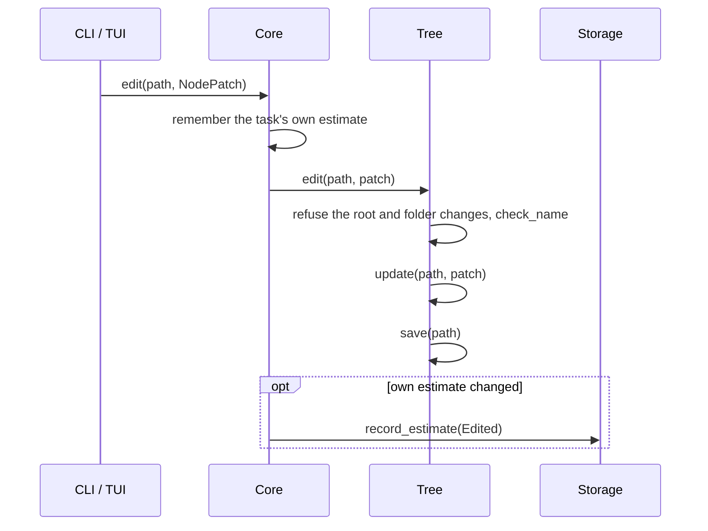
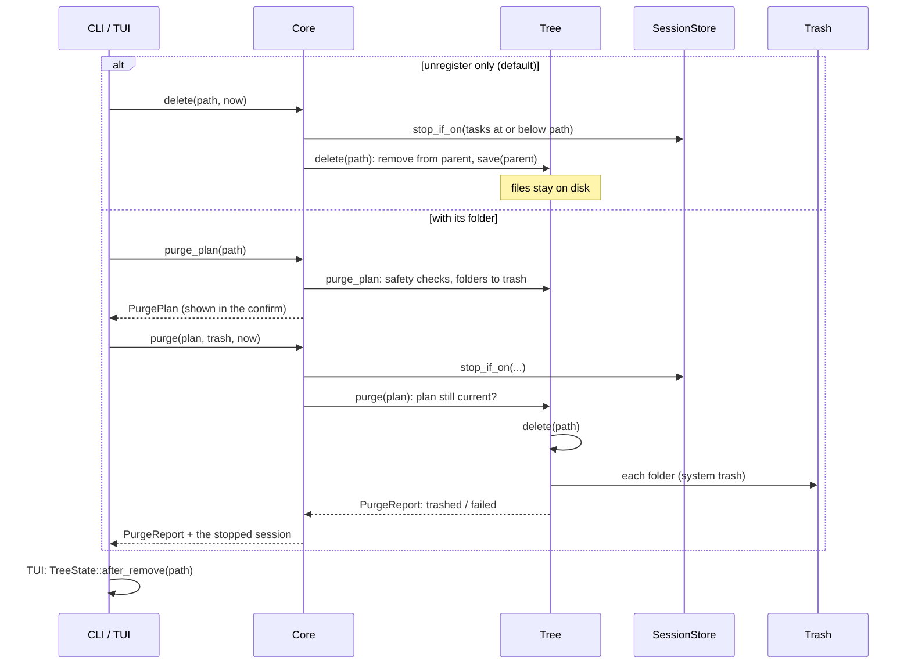
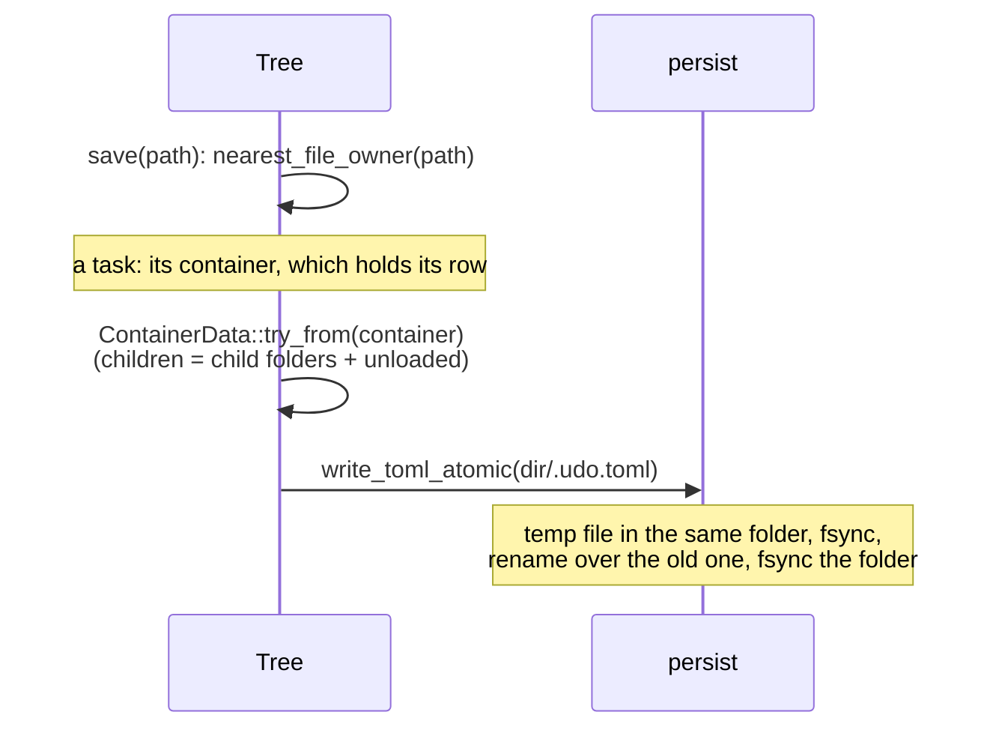
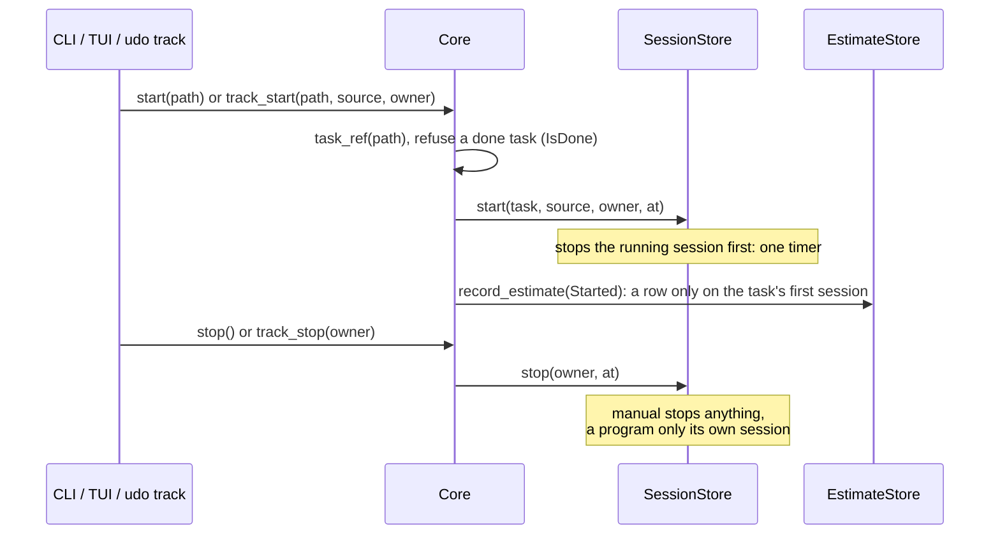

# Flows

What happens on load and on each kind of change. Every change goes through
`Core` (`src/core/`), from the CLI and the TUI alike. Two rules hold
everywhere:

- **Checks before the disk:** a failed call leaves nothing behind.
- **The action first, the record second:** an estimate row is written
  after the action; if that fails, the action stands and a warning says so
  ([estimates.md](estimates.md#recording)).

## Load at startup

## Create

The TUI hands the terminal to the script (`Flow::Run`) and resumes after
it.

## Edit

Settings go through their own call (`Core::set_settings` ->
`Tree::set_settings`): only containers have them, `[root]` settings only
the root.

## Delete

- A running timer on a removed task is stopped first.
- Sessions and estimate rows of removed tasks are kept (they feed the
  estimates).
- Unregistering comes before trashing: if trashing fails halfway, udo is
  still consistent and the report names what is left on disk.
- `after_remove` keeps the TUI cursor valid: a later sibling shifts left;
  on the removed node it takes the next sibling, else the previous one,
  else the parent.

## Save

## Timer

Adding a session by hand (`Core::add_session`) records `Started` the same
way. Corrections (edit, split, cut, remove) only change sessions; removed
ones are marked, never deleted ([storage.md](storage.md#sessions)).
