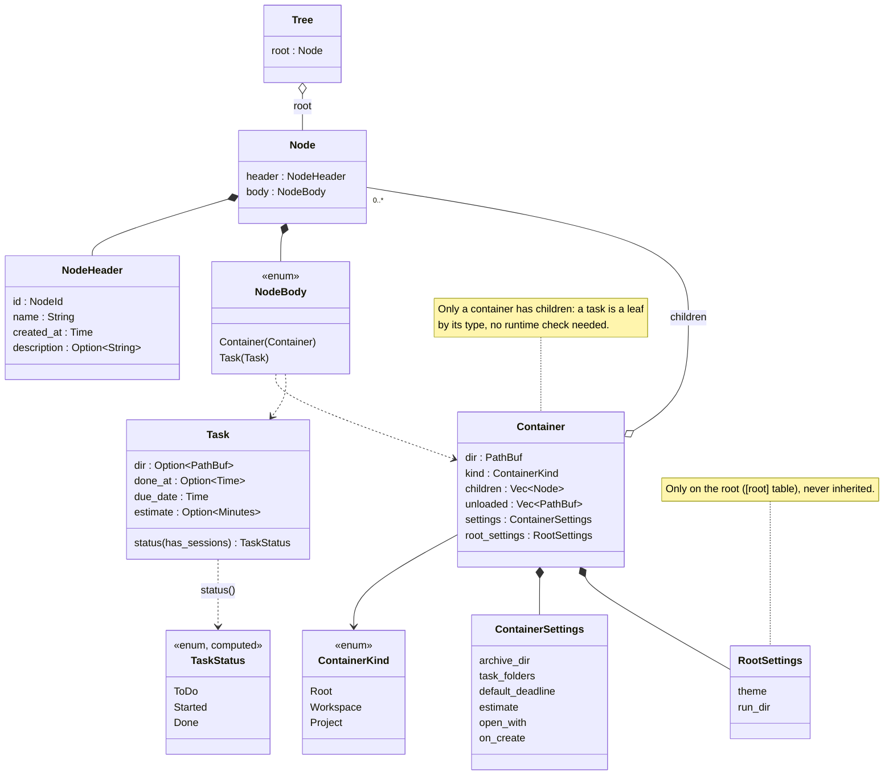

# The tree

The tree of workspaces, projects and tasks, in memory (`src/model/`) and on
disk (`.udo.toml`, `src/model/data.rs`).

## Types



- **Two ways to point at a node.** `NodePath` (`Vec<usize>`) is a position:
  the child indices from the root, `[]` is the root. It changes when nodes
  are added or removed before it. `NodeId` (UUID v7) never changes: sessions,
  estimate rows and `view.toml` use it.
- **`header` / `body`.** What every node has (id, name, creation time,
  description) is in `NodeHeader`; what only a container or only a task has
  is in the `NodeBody`.
- **Settings are inherited.** Every `ContainerSettings` field is optional:
  unset means "take it from the parent", up to a built-in default. A task
  has no settings, only its own fields (`Task::estimate` is the task's own
  guess, not the container setting of the same name).
- **`TaskStatus` is not stored.** `Task::status` computes it: done if
  `done_at` is set, started if the task has a session, else to do.
- **Patches.** `NodePatch` (`HeaderPatch` + a `BodyPatch` for containers or
  tasks) describes an edit. A plain `Option` field means keep or set; an
  `Option<Option<_>>` (description, `done_at`, `estimate`) also allows
  removing: `None` keep, `Some(None)` remove, `Some(Some(v))` set.

## On disk

Every container, the root included, has its own `.udo.toml` in its folder.
A task has no file of its own: it is a row in its container's file. A child
container is listed only by its folder; its content is in its own file.

```mermaid
flowchart LR
    subgraph mem["Tree in memory"]
        root(["root"]) --> rent["pay rent (task)"]
        root --> uni(["uni (workspace)"])
        uni --> cs(["cs (project)"])
        cs --> lab["lab 3 (task)"]
    end
    subgraph disk["Files"]
        f_root["~/.config/udo/.udo.toml<br/>tasks: pay rent<br/>children: ~/uni"]
        f_uni["~/uni/.udo.toml<br/>children: cs"]
        f_cs["~/uni/cs/.udo.toml<br/>tasks: lab 3"]
    end
    root -.-> f_root
    uni -.-> f_uni
    cs -.-> f_cs
```



The file is `ContainerData` (header, `kind`, `tasks`, `children`, the
settings flattened in, `[root]` only on the root); each task row is a
`TaskData` (header and task fields side by side):

```toml
id = "01a10224-0f2b-77da-adc0-deaeebedad96"
name = "cs"
created_at = "2026-10-01T09:12:00+02:00"
kind = "Project"
children = []
estimate = "1h30"

[[tasks]]
id = "01a10224-11c4-7c1e-9a0f-3b6d2e8f4a21"
name = "lab 3"
created_at = "2026-10-02T14:00:00+02:00"
dir = "lab_3"
due_date = "2026-10-16T22:00:00+02:00"
```

- **Paths** inside the container's own folder are written relative (the
  folder can move, e.g. another machine or a git checkout); others stay
  absolute.
- **`unloaded`**: child folders listed in a file but not loadable (a drive
  not mounted, a missing `.udo.toml`). Not shown, but written back on save,
  so they stay registered.
- Only set values are written: a file shows what that container overrides.
- The format only changes in ways old files survive (see
  [CONTRIBUTING](../../CONTRIBUTING.md#data-formats)).

## View state

The TUI's cursor and folded containers are not part of the tree:
`TreeState` (`src/tui/tree_state.rs`) keeps them, and `view.toml` in the
root folder stores the folded containers and the selected node by
`NodeId`. Using the TUI never touches a `.udo.toml`, and the state survives
renames, moves and index shifts.

Rows are shown sorted (open tasks, done tasks, then containers, each by
name), but a row's `NodePath` stays the stored index, so `Tree::get` finds
it.
