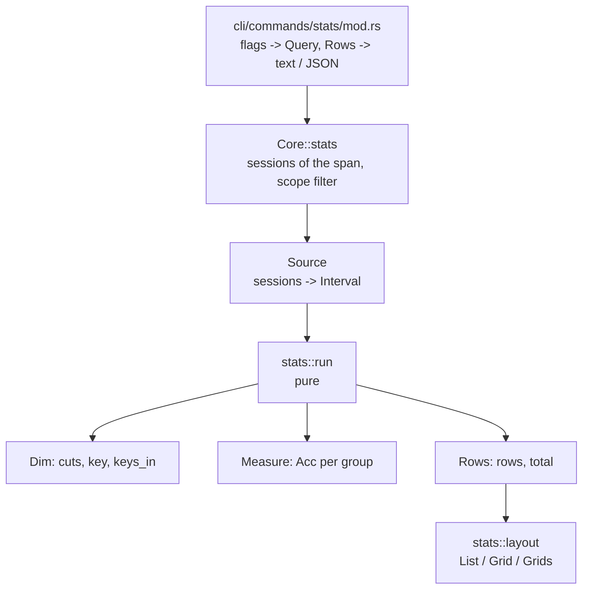

# Stats

`udo stats`: where the time went, grouped by any dimensions and counted by
any measures (`src/stats/`). The engine is pure, like `estimate`: no `Core`,
no I/O, no async. The zone and `now` come in from the caller, so the tests
run in a fixed zone (`Europe/Berlin`, for the DST days), never the
machine's.



## The pipeline

`Core::stats` loads the sessions of the span with `include_deleted: false`
and keeps those in the scope (`model::sessions::in_scope`, the filter
`session list` uses). `SessionsSource` turns them into `Interval`s; a
running session ends at `now`. Then `stats::run`:

1. Clips each interval to `[from, to)` and drops the empty ones.
2. Collects the cuts of all dimensions (sorted, deduplicated) and cuts each
   interval at them into `Piece`s. A piece lies inside one key of every
   dimension, so 23:30 to 00:30 is 30 minutes on each of two days.
3. Keys every piece by every dimension (`Dim::key`, with the span) and adds
   it to the accumulators of its key. The total gets every piece too.
4. Fills in the keys a dimension enumerates (`keys_in`): all buckets of the
   span, all 24 hours, all weekdays, also the empty ones (0). Node
   dimensions only show the keys that occur.
5. Sets `occurrences` per row: how often its key occurs in the span. One
   enumerating dimension: its own count (a month has 4 or 5 Mondays). Two
   or more: counted jointly, not as a product, so (Mon, 9h) over October is
   4, not 4 × 31.
6. Returns the rows in display order, and the `total`: one row over the
   whole span, with the same measures.

`stats::layout` turns the rows into a `Layout`: `Total` (0 dimensions: the
total is the only number), `List` (1 dimension), `Grid` (2) or `Grids` (3 or
more: one grid per value of the outer dimensions). It holds the numbers and
the keys, never the text. The text comes from `stats::layout::label`, one arm
per `KeyPart`; `label_in_span` adds the span: a day label names its month
across months, and a bucket of `every > 1` is a range (`Jan – Jun 2026`).
The CLI renders the text, and the TUI (#84) will draw the same layout.

## Types

| Type | Where | What |
|------|-------|------|
| `Query` | `stats/mod.rs` | span `from` / `to`, `dims`, `measures`, `include_removed_tasks`. The JSON form of a query: `--json` echoes it |
| `Interval` | `stats/interval.rs` | one stretch of time from one source, with its task and session |
| `Piece` | `stats/interval.rs` | an interval cut to the span and to every boundary |
| `Key`, `KeyPart` | `stats/mod.rs` | one part per dimension, in query order |
| `Row`, `Rows` | `stats/mod.rs` | a key, its values by measure name, `occurrences`; `Rows` adds the total |
| `DimSpec`, `MeasureSpec`, `Unit`, `Level` | `stats/spec.rs`, `stats/dims/calendar.rs` | the serde enums a query is written in |

The three traits, one file per implementation:

| Trait | Files | Methods |
|-------|-------|---------|
| `Dim<Tz>` | `dims/mod.rs`: `calendar`, `hour`, `weekday`, `node` | `name`, `cuts`, `key`, `keys_in` |
| `Measure` | `measures/mod.rs`: `minutes`, `sessions` | `name`, `new_acc` (an `Acc`: `add`, `value`) |
| `Source` | `sources/mod.rs`: `sessions` | `intervals(from, to, now)` |

`DimSpec::build` returns the `Dim`; `MeasureSpec::build` the `Measure`.
`DimSpec` is `#[serde(tag = "dim")]`, so a dimension is written as, for
example, `{"dim": "calendar", "unit": "day", "every": 1}`.

## Dimensions

- **Calendar** `{ unit: day | week | month | year, every }`. Buckets start at
  local midnight; weeks on Monday (Monday 00:00 to Monday 00:00, fixed, no
  setting); months on the 1st; years on 1 January. `every > 1` aligns the
  buckets to the span's `from`, not to the epoch: `--from "2026-01-01 00:00"
  --every 6months` gives January to June, then July to December. Edge
  buckets are cut to the span.
- **Hour**: local hour of the day, 0 to 23. A DST day's repeated hour
  counts twice, a skipped one not.
- **Weekday**: Monday to Sunday, local. Cuts at every local midnight.
- **Node** `{ level: task | project | workspace | child }`. `task` is the
  task; `project` and `workspace` are its nearest ancestor of that kind;
  `child` is the child of the scope the task lies under, or the task itself
  when it lies directly in the scope. A node without an
  ancestor of the kind is the root, shown `(root)`, never a "none" key.
  Removed tasks (only with `--deleted`) are one key per task at level
  `task`, and one `(removed)` key for the coarser levels.

Sessions you deleted (`deleted_at`) never count, with or without
`--deleted`; `--deleted` only adds the sessions of removed tasks.

## Measures

- **minutes**: the sum of the pieces' lengths, in seconds. Shown as whole
  minutes (see Rounding).
- **sessions**: the distinct session ids that touch the group. A session
  cut across two days counts on each; the total counts it once.

## Adding something later

A new dimension or measure is one file plus a few registration arms, as far
as the existing key kinds go. A dimension that produces a new kind of key is
more (see the last step below).

**A dimension** (say, part of day, or done / open):

1. `src/stats/dims/<name>.rs`: `impl<Tz: TimeZone> Dim<Tz>`. Its `cuts` must
   make every piece fall into one key; `keys_in` returns `None` when the
   keys come only from the data.
2. One `DimSpec` variant in `src/stats/spec.rs`, and its arm in `build`.
   `DimSpec::name` builds the dimension and asks it, so it needs no arm.
3. One CLI name in `ByDim` (`src/cli/commands/stats/mod.rs`), and its `From`
   arm.
4. Its tests, next to the file (as `hour.rs` and `calendar.rs` do) and the
   DST case if the zone matters.
5. One arm in `any_dim()` in `src/stats/tests.rs`, so the invariant covers
   it.
6. Only if its keys are a new kind (not `Calendar`, `Hour`, `Weekday` or
   `Node`): a `KeyPart` variant in `src/stats/mod.rs`, with its place in
   `KeyPart::rank`, a same-kind arm in `Ord for KeyPart`, an arm in
   `layout::label` (`src/stats/layout.rs`) and in `key_json`
   (`src/cli/commands/stats/mod.rs`). The compiler finds the matches that need
   one. Careful with `Ord`: the cross-kind arm lists every variant, so a new
   variant does not compile until it is listed, but the same-kind arm is
   still yours to add. Two values of a kind with no same-kind arm compare as
   `Equal`, which silently merges their groups.

**A measure** (distinct tasks, planned minutes):

1. `src/stats/measures/<name>.rs`: `impl Measure` (`name`, `new_acc`) and an
   `Acc`.
2. One `MeasureSpec` variant in `spec.rs`, and its arm in `build`.
3. Its tests. The CLI asks for `minutes` and `sessions` only, so a new
   measure reaches the output once the CLI adds it.

**A source** (timetable blocks, planned time): `src/stats/sources/<name>.rs`
with `impl Source`, and a `SourceKind` variant for its intervals. Today
`Core::stats` builds `SessionsSource` directly: a new source is wired in
there (there is no `SourceSpec` yet).

## Invariant

`invariant_total_unchanged` (proptest, `src/stats/tests.rs`): random
intervals with fixed ends (across midnight, around the DST days, some on a
removed task), a random span and a random list of up to three dimensions
from `any_dim()`. Grouping never changes the total: the sum of the rows, in
seconds, equals the clipped length of the input, and so does `total`.
Running sessions, which end at `now`, are covered by
`running_session_counts_to_now`.

## Rounding

Sums are taken in seconds. `stats::minutes_of` is the one place that turns
them into minutes: whole minutes, rounded down, per row. So a total can
differ from the sum of its rounded rows by up to one minute per row, and from
`session list`, which rounds per session. The invariant holds in seconds.
One rounding rule for all of udo is #85: swapping it means changing
`minutes_of` only.

## JSON

`udo stats --json` is the `StatsReport` (`src/cli/commands/stats/mod.rs`):

```
sections[] -> { title, parts[] -> { query, total, rows[] } }
```

- `query`: the `Query` as run (`from`, `to`, `dims` as `{dim, ...}`,
  `measures`, `include_removed_tasks`). Times are RFC 3339.
- `total` and each row: `key`, the measures flat (`minutes`, `sessions`),
  and `occurrences`. `total` has an empty `key`.
- `key` has one field per dimension, named by the dimension (`day`, `week`,
  `month`, `year`, `hour`, `weekday`, `task`, `project`, `workspace`,
  `child`):
  - calendar: `{ start, end }`
  - node: `{ id, path }`, the root has `path` `""`
  - removed task (`task` level, `--deleted`): `{ id, name, removed: true }`
  - removed group (coarser levels, `--deleted`): `{ removed: true }`
  - hour: the number, 0 to 23
  - weekday: `"mon"` to `"sun"`

Once shipped, the JSON only grows: new fields are additive, and a field is
never renamed or removed.
