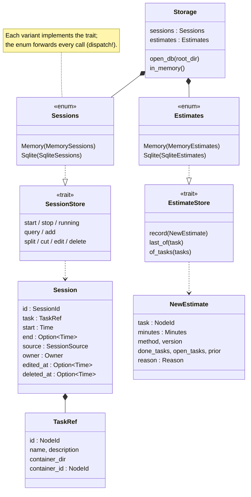

# Storage

What is recorded over time lives in `udo.db` (SQLite, in the root folder):
the sessions and the estimate history. The tree itself is still in the
`.udo.toml` files ([model.md](model.md)).

- **One trait per kind of data**, two backends each: in memory (tests) and
  SQLite. `Sessions` / `Estimates` are enums over the backends, not `dyn`
  (the trait methods are async). `Storage::open_db` opens SQLite,
  `Storage::in_memory` the memory backends.
- **The same contract for every backend:** `session_store_contract!` and
  `estimate_store_contract!` run one test per rule against each backend; the
  session stores also have a differential test (memory vs. SQLite). A new
  backend implements the trait and runs the contract.
- **Several writers are safe:** the TUI, CLI calls, `udo track` helpers and
  tmux hooks can write at once (WAL, `busy_timeout`, `BEGIN IMMEDIATE`). A
  check and its write are one step in the store, e.g. "start stops the
  running session" or "skip a repeated estimate row".
- **Migrations** are the files in `src/storage/sqlite_migrations/`
  (`001_sessions.sql`, `002_estimates.sql`, ...), run in order;
  `PRAGMA user_version` counts how many have run. Released migrations are
  never edited, new ones are additive.

## Sessions

- One session per span of work, with start and end (a running one has no
  end), its `source` (`manual` or a program like `tmux`), and its `owner`
  (who may stop it: `manual` always wins, a program only stops its own).
- **Never deleted.** A removed session is only marked (`deleted_at`); every
  correction is logged in `session_edits`. A session keeps a `TaskRef`
  (the task's id, name, description and container), so it outlives its
  task: the history feeds the estimates.
- One timer: starting a session stops the running one.

## Estimate rows

- `estimates` is append-only: one row per moment udo estimated a task
  (created, first session, own estimate set or removed), with the method,
  its version and what it learned from (`NewEstimate`). Rows stay when the
  task is deleted.
- `record` skips a row that repeats the latest row of its chain (same
  minutes, method and prior source). A chain: yours (`manual`) or learned,
  times `created` / `started` or not, so a `manual` row never hides a
  learned repeat and a `cleared` one never a `started` one (#60). When rows
  are written: [estimates.md](estimates.md#recording).
- Since migration 003 a row also says where its prior came from
  (`prior_source`: `none`, `setting`, `parent`; `prior_container`,
  `prior_tasks`). NULL: written before; such rows are never changed, a
  newer row supersedes them.
