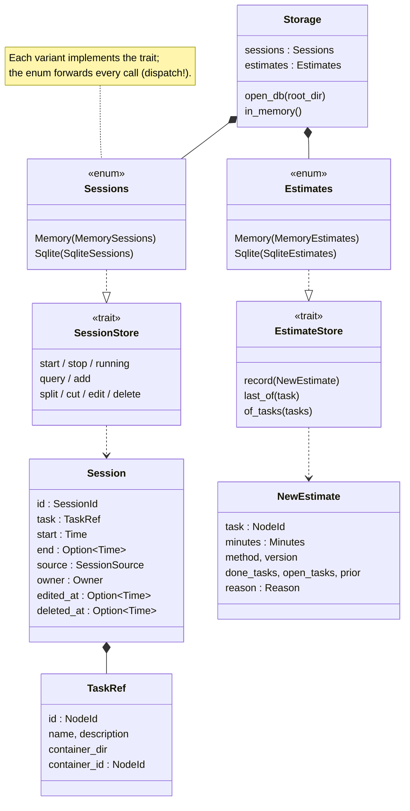

# Storage

What is recorded over time lives in `udo.db` (SQLite, in the root folder):
the sessions and the estimate history. The tree itself is still in the
`.udo.toml` files ([model.md](model.md)).

- **One trait per kind of data**, two backends each: in memory (tests) and
  SQLite. `Sessions` / `Estimates` are enums over the backends, not `dyn`
  (the trait methods are async). `Storage::open_db` opens SQLite,
  `Storage::in_memory` the memory backends.
- **The same contract for every backend:** `session_store_contract!` and
  `estimate_store_contract!` run one test per rule against each backend; the
  session stores also have a differential test (memory vs. SQLite). A new
  backend implements the trait and runs the contract.
- **Several writers are safe:** the TUI, CLI calls, `udo track` helpers and
  tmux hooks can write at once (WAL, `busy_timeout`, `BEGIN IMMEDIATE`). A
  check and its write are one step in the store, e.g. "start stops the
  running session" or "skip a repeated estimate row".
- **Migrations** are the files in `src/storage/sqlite_migrations/`
  (`001_sessions.sql`, `002_estimates.sql`, ...), run in order;
  `PRAGMA user_version` counts how many have run. Released migrations are
  never edited, new ones are additive.
- **Before a migration** an existing database is copied next to it,
  named after its version and the time (`udo.db.v2.20261028-014000.bak`,
  #78): migrations are one-way, an older udo refuses the result. Each
  upgrade gets its own copy, also after a roll back and a later upgrade.
  `VACUUM INTO` a file of its own, synced, then hard-linked into place,
  never over an existing file: two processes upgrading in the same second
  leave one whole copy. Where links are not supported (exFAT, some network
  drives) a rename instead, which in that race may replace the other
  copy, one of the same data. A copy is checked before it is placed: if
  another process migrated in between, it holds the new schema and is
  dropped, so a `v2` copy always holds schema 2. A failed copy refuses the
  migration (the database stays as it was); a path that is not UTF-8 gets
  no copy and is migrated as before. udo never deletes the copies.

## Sessions

- One session per span of work, with start and end (a running one has no
  end), its `source` (`manual` or a program like `tmux`), and its `owner`
  (who may stop it: `manual` always wins, a program only stops its own).
- **Never deleted.** A removed session is only marked (`deleted_at`); every
  correction is logged in `session_edits`. A session keeps a `TaskRef`
  (the task's id, name, description and container), so it outlives its
  task: the history feeds the estimates.
- One timer: starting a session stops the running one.

## Estimate rows

- `estimates` is append-only: one row per moment udo estimated a task
  (created, first session, own estimate set or removed), with the method,
  its version and what it learned from (`NewEstimate`). Rows stay when the
  task is deleted.
- `record` skips a row that repeats the latest row of its chain (same
  minutes, method, prior source and moment). The chains: all of yours
  (`manual`, whatever the reason: never frozen); learned `created` /
  `started` rows; the other learned ones (`cleared`). So a `manual` row
  never hides a learned repeat, a `cleared` one never a `started` one, and
  your unchanged estimate is one row (#60). When rows are written:
  [estimates.md](estimates.md#recording).
- Since migration 003 a row also says where its prior came from
  (`prior_source`: `none`, `setting`, `parent`; `prior_container`,
  `prior_tasks`) and, a learned `created` / `started` row, the moment it
  was computed for (`frozen_at`, `frozen_at_offset`: the task's first
  session, else its creation, to the millisecond). A done task's estimate
  is read from the row for its current moment. NULL: written before (or
  not a moment); such rows are never changed, a newer row supersedes them.
