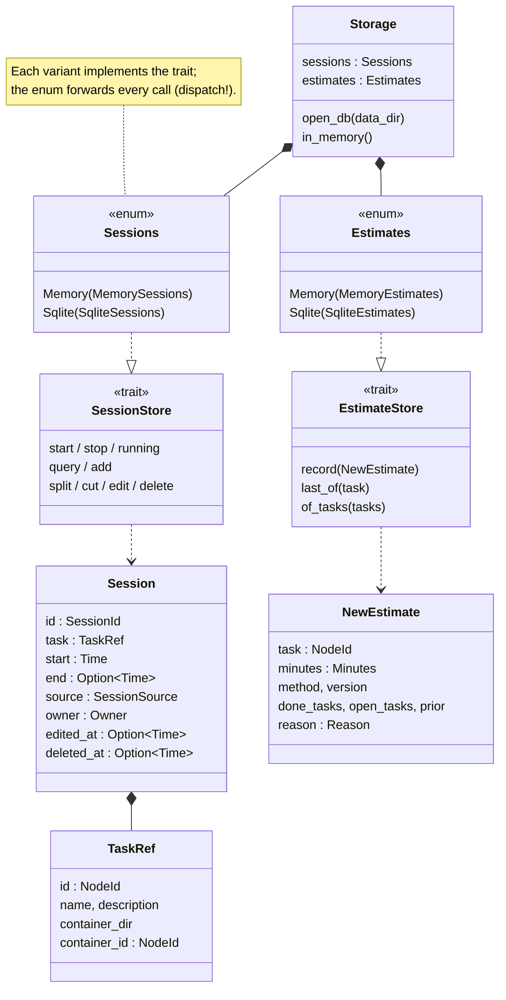

# Storage

What is recorded over time lives in `udo.db` (SQLite, in the data dir):
the sessions and the estimate history. The tree itself is still in the
`.udo.toml` files in the config root ([model.md](model.md)).

- **One trait per kind of data**, two backends each: in memory (tests) and
  SQLite. `Sessions` / `Estimates` are enums over the backends, not `dyn`
  (the trait methods are async). `Storage::open_db` opens SQLite,
  `Storage::in_memory` the memory backends.
- **The same contract for every backend:** `session_store_contract!` and
  `estimate_store_contract!` run one test per rule against each backend; the
  session stores also have a differential test (memory vs. SQLite). A new
  backend implements the trait and runs the contract.
- **Several writers are safe:** the TUI, CLI calls, `udo track` helpers and
  tmux hooks can write at once (WAL, `busy_timeout`, `BEGIN IMMEDIATE`). A
  check and its write are one step in the store, e.g. "start stops the
  running session" or "skip a repeated estimate row".
- **Migrations** are the files in `src/storage/sqlite_migrations/`
  (`001_sessions.sql`, `002_estimates.sql`, ...), run in order;
  `PRAGMA user_version` counts how many have run. Released migrations are
  never edited, new ones are additive.
- **Before a migration** an existing database is copied next to it,
  named after its version and the time (`udo.db.v2.20261028-014000.bak`,
  #78): migrations are one-way, an older udo refuses the result. Each
  upgrade gets its own copy, also after a roll back and a later upgrade.
  `VACUUM INTO` a file of its own, synced, then hard-linked into place,
  never over an existing file: two processes upgrading in the same second
  leave one whole copy. Where links are not supported (exFAT, some network
  drives) a rename instead, which in that race may replace the other
  copy, one of the same data. A copy is checked before it is placed: if
  another process migrated in between, it holds the new schema and is
  dropped, so a `v2` copy always holds schema 2. A failed copy refuses the
  migration (the database stays as it was); a path that is not UTF-8 gets
  no copy and is migrated as before. udo never deletes the copies.

## Where the database lives

`dir::dirs()` resolves two dirs (#93), first match wins for the data dir:

1. `$UDO_DATA` if set.
2. The config root is the default `~/.config/udo` (however spelled: hooks
   carry it explicitly) → the platform data dir
   (`~/Library/Application Support/udo`, `$XDG_DATA_HOME/udo`).
3. A custom `$UDO_ROOT` → that root: tests, `cargo run` and throwaway roots
   stay self-contained and never reach the real data dir.

The defaults are looked up once (`dir::defaults()`); without a home dir
only the env vars count (`$UDO_ROOT` is then needed). The data dir is
created `0700`. A debug build refuses the real root and the real data dir.

**Moving an old database** (`storage::relocate`, cases 1 and 2: whenever
the data dir is another dir than the root, at startup before anything
opens a database): `<root>/udo.db` from 0.5 or older, or of a custom root
given a `$UDO_DATA`, goes to the data dir once.

- A lock file (`.udo-move.lock`) keeps two udo processes from moving at
  once; the second waits, then finds nothing left to move.
- The old file is opened exclusively (`locking_mode=EXCLUSIVE`): another
  connection that merely has it open (a running TUI, also an older one)
  makes this fail at once (no busy wait), and nothing is changed: this run
  opens the old file where it is (startup's `settle_old_db`), keeping a
  connection to it opened under the lock so no other udo moves it
  meanwhile; the move happens on a later start. With a `udo.db` in the
  data dir too, udo stops instead, as on every other refusal: "two
  databases" if it holds other data (closing the holder would not help),
  else "in use" (a move cut short, finished once the holder is closed).
- WAL checkpoint, `integrity_check`, `VACUUM INTO` a temp file, the copy
  checked (`integrity_check`, same schema version, same row count per
  table), synced, placed with `place` as above, checked again.
- The old file is renamed to `udo.db.moved.<time>.bak` next to it, still
  under the lock; its empty `-wal` / `-shm` go only if no new `udo.db`
  appeared in the root meanwhile.
- A crash before the copy is placed leaves the old file untouched; after
  it, both files hold the same data and the next start only renames. Two
  databases with different data (an older udo made a fresh one after the
  move) are refused, never merged or picked.

Earlier `udo.db.v*.bak` copies stay in the root.

## Sessions

- One session per span of work, with start and end (a running one has no
  end), its `source` (`manual` or a program like `tmux`), and its `owner`
  (who may stop it: `manual` always wins, a program only stops its own).
- **Never deleted.** A removed session is only marked (`deleted_at`); every
  correction is logged in `session_edits`. A session keeps a `TaskRef`
  (the task's id, name, description and container), so it outlives its
  task: the history feeds the estimates.
- One timer: starting a session stops the running one.

## Estimate rows

- `estimates` is append-only: one row per moment udo estimated a task
  (created, first session, own estimate set or removed), with the method,
  its version and what it learned from (`NewEstimate`). Rows stay when the
  task is deleted.
- `record` skips a row that repeats the latest row of its chain (same
  minutes, method, prior source and moment). The chains: all of yours
  (`manual`, whatever the reason: never frozen); learned `created` /
  `started` rows; the other learned ones (`cleared`). So a `manual` row
  never hides a learned repeat, a `cleared` one never a `started` one, and
  your unchanged estimate is one row (#60). When rows are written:
  [estimates.md](estimates.md#recording).
- Since migration 003 a row also says where its prior came from
  (`prior_source`: `none`, `setting`, `parent`; `prior_container`,
  `prior_tasks`) and, a learned `created` / `started` row, the moment it
  was computed for (`frozen_at`, `frozen_at_offset`: the task's first
  session, else its creation, to the millisecond). A done task's estimate
  is read from the row for its current moment. NULL: written before (or
  not a moment); such rows are never changed, a newer row supersedes them.
